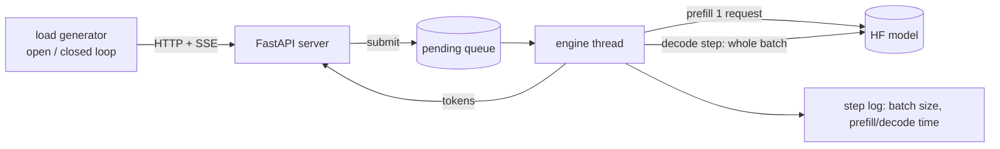

# llm-inference

A small LLM serving stack **built to be measured**: a from-scratch continuous-batching engine for
Hugging Face causal LMs, an OpenAI-compatible server, an open-loop load generator, and a set of
experiments that explain *why* the numbers look the way they do (scheduling, roofline, precision).

Successor to [llm-inference-benchmark-lab](https://github.com/Shivanim042003/llm-inference-benchmark-lab),
which measured a naive CPU server. This project builds the serving system and benchmarks it
against a production engine (vLLM).

## What is in here

| Layer | What | Where |
|---|---|---|
| Engine | Iteration-level (continuous) batching on a left-padded KV cache; same code path runs sequential, static and continuous policies so comparisons isolate the scheduler | `src/llmserve/engine.py` |
| Server | OpenAI-compatible `/v1/chat/completions` with SSE streaming, `/stats`, `/engine_stats` | `src/llmserve/server.py` |
| Load generation | Open-loop Poisson arrivals (exposes queueing and tail latency) and closed-loop concurrency | `src/llmserve/loadgen.py` |
| Metrics | TTFT, TPOT, E2E percentiles, **SLO attainment and goodput**, bootstrap CIs | `src/llmserve/metrics.py` |
| Analysis | Prefill/decode microbenchmarks, achieved memory bandwidth vs roofline, `torch.profiler` tables | `src/llmserve/microbench.py` |
| Precision | fp32 / fp16 / int8 / nf4: throughput, GPU memory, perplexity, greedy-output agreement | `src/llmserve/quality.py` |
| Ablation | Prefill computes the lm_head only for the last prompt position vs every position (same server, same load, same session) | `src/llmserve/engine.py`, `experiments.py` |
| Baseline | Same load against vLLM serving the same model | `src/llmserve/experiments.py` |
| Reports | Figures, tables and findings generated from the CSVs (no hand-written numbers) | `src/llmserve/report.py` |

## Design



* **One batched forward pass per decode step.** Rows of different lengths share a left-padded KV
  cache `[B, H, T, D]` with an explicit attention mask and per-row position ids.
* **Admission** runs the new request's prefill separately and left-pads/concatenates its cache into
  the running batch; **finished rows** are dropped and all-padding columns trimmed.
* **Policies:** `sequential` (batch of 1), `static` (admit only when the batch has drained),
  `continuous` (admit every step, at most `max_prefill_per_step` prefills per step to bound decode stalls).
* **Correctness:** `tests/test_engine.py` checks that every policy produces exactly the tokens of an
  uncached, unbatched reference (fp64 tiny model), including EOS handling and the background thread.

## Methodology

* **Open-loop** load (Poisson arrivals) for latency/capacity: arrivals do not slow down when the
  server does, so overload shows up as queueing instead of being hidden (coordinated omission).
* **Closed-loop** load only for peak-throughput numbers, with repeats and spread.
* **Workload `mixed`:** prompts of 16-256 words and outputs of 16-256 tokens, fixed output length
  (`ignore_eos`) so every engine does identical work.
* **SLO:** TTFT <= 1 s and TPOT <= 100 ms. *SLO capacity* = highest offered rate where >= 95% of
  requests meet both and none fail. *Goodput* = rate of requests that meet the SLO.
* Requests still running 45 s after the last arrival are cancelled and counted as failed (overload).

## Results

<!-- RESULTS:START -->
**Setup:** model `Qwen/Qwen2.5-0.5B-Instruct`, float16, hardware: Tesla T4, torch 2.11.0+cu130, transformers 5.20.2, run date 2026-10-25 18:22:17 UTC, commit `f7ef35f`.

### Key findings (auto-generated from the data)

- Sequential serving never met the SLO at any tested rate, while continuous-16 sustained 4 req/s, continuous-32 sustained 6 req/s, vllm sustained 12 req/s.
- At 4 req/s (the highest rate where continuous-16 meets the SLO), continuous batching has 51x lower p95 TTFT than static batching of the same size (0.66s vs 33.56s). Static batching meets the SLO at no tested rate.
- Against vLLM on the same GPU, our best engine (continuous-32, SLO capacity 6 req/s) reaches 50% of vLLM's SLO capacity (12 req/s).
- Closed-loop peak: **continuous-16** 332 tok/s = 11.2x sequential (30 tok/s).
- Closed-loop peak: **continuous-32** 509 tok/s = 17.2x sequential (30 tok/s).
- Closed-loop peak: **static-16** 176 tok/s = 5.9x sequential (30 tok/s).
- Closed-loop peak: **vllm** 1413 tok/s = 47.6x sequential (30 tok/s).
- Decode step time is nearly flat in batch size: within 1.5x of batch 1 (34.09 ms) up to batch **32**, where decode tokens/s is 31.4x batch 1. This is why batching raises throughput.
- At batch 128 a decode step takes 104.29 ms, 4.2% of the assumed 320 GB/s peak bandwidth: well below the memory roofline, so the step is not bandwidth-bound; kernel-launch / Python overhead is the likely limiter (check profile_decode.txt).
- Prefill of a 2048-token prompt takes 419.1 ms when only the last position's logits are computed vs 434.0 ms with full-vocab logits at every position (1.0x).
- Computing the lm_head only for the last prompt position does not measurably change closed-loop throughput (291 -> 288 tok/s, 0.99x; run-to-run spread is not shown, so treat differences under ~5% as noise) and moves the share of GPU time spent in prefill from 12% to 12%.
- float16/int8: 0.27x throughput vs fp32, perplexity 22.455 vs 22.426, greedy outputs match fp32 for the first 58% of tokens on average.
- float16/nf4: 0.84x throughput vs fp32, perplexity 25.025 vs 22.426, greedy outputs match fp32 for the first 17% of tokens on average.
- float16/none: 1.15x throughput vs fp32, perplexity 22.417 vs 22.426, greedy outputs match fp32 for the first 98% of tokens on average.


Full tables and methodology: [reports/RESULTS.md](reports/RESULTS.md).
<!-- RESULTS:END -->

## Reproduce

```bash
pip install -e .            # needs a working torch install
make test                   # 19 CPU tests, ~20 s, no downloads
make smoke                  # full pipeline on CPU with a tiny random model
make t4                     # real experiments on a GPU (Qwen2.5-0.5B-Instruct)
```

The Colab notebook in this repo runs everything end to end and pushes results back.

## Limitations (read before quoting numbers)

* One small model (Qwen2.5-0.5B), one GPU class; results do not transfer to larger models or other GPUs.
* No paged attention and no chunked prefill: prefill is one request at a time, and left-padding wastes
  memory/compute when lengths differ. Greedy decoding only.
* The engine is Python + eager PyTorch; at this model size, per-step overhead (not memory bandwidth)
  is expected to dominate. vLLM comparisons measure that gap, they are not a claim of parity.
* The load generator runs on the same machine as the server (Colab has 2 vCPUs); at high request
  rates this can perturb measurements.
* Free-tier shared GPUs vary between sessions; compare numbers only within one run.
* The quantization experiment measures speed/memory/quality on this model only.

## License

MIT. See [LICENSE](LICENSE).
