# llm-inference

A small LLM serving stack **built to be measured**: a from-scratch continuous-batching engine for
Hugging Face causal LMs, an OpenAI-compatible server, an open-loop load generator, and a set of
experiments that explain *why* the numbers look the way they do (scheduling, roofline, precision).

Successor to [llm-inference-benchmark-lab](https://github.com/Shivanim042003/llm-inference-benchmark-lab),
which measured a naive CPU server. This project builds the serving system and benchmarks it
against a production engine (vLLM).

> **TL;DR.** A from-scratch LLM serving stack for Hugging Face models (continuous batching, OpenAI-compatible
> streaming server, open-loop load generator) plus the experiments that explain *why* it performs the way it does.
> On a Colab T4 with Qwen2.5-0.5B, the profile showed decoding was launch-overhead-bound (~9% of memory bandwidth,
> ~36 ms per step at any batch size). Replacing the growing KV cache with static slots and CUDA graphs raised
> SLO capacity from **4 to 10 req/s (2.5x)** and closed-loop throughput from **414 to 964 tok/s (2.3x)** on the same
> model, GPU and load. vLLM reaches 12 req/s and 1399 tok/s on the same setup; this engine is at about 83% and 69% of that.

| Engine (T4, Qwen2.5-0.5B, fp16) | SLO capacity (req/s) | Closed-loop peak (tok/s) |
|---|---|---|
| Sequential | 0 (SLO never met) | 26 |
| Static batching (16) | 0 (SLO never met) | 161 |
| Continuous batching, dynamic KV cache | 4, in [4, 6) | 414 ± 13 |
| Static KV slots (eager) | 4, in [4, 6) | 477 ± 11 |
| **Static KV slots + CUDA graphs** | **10, in [10, 12)** | **964 ± 14** |
| vLLM (baseline) | 12, in [12, 16) | 1399 |

SLO: TTFT <= 1 s and TPOT <= 100 ms; capacity = highest offered rate where >= 95% of requests meet it, in every seed.
Open-loop points use 2 seeds; closed-loop points use 3 repeats (mean ± sd).

**What worked**
- Diagnosing before optimizing: the roofline and profiler showed decode was overhead-bound, which pointed at CUDA graphs.
- CUDA graphs: decode kernel 3.6-4.6x faster; the gain holds on a second, larger model (Qwen2.5-1.5B: 391 vs 223 tok/s).
- Continuous vs static batching: 195x lower p95 TTFT at 3 req/s.
- Prefix caching on a shared-preamble workload: 89% prefix-token hit rate, p95 TTFT 0.71-0.96x of uncached (a modest gain that shrinks near saturation).

**What did not work (kept in the repo on purpose)**
- Chunked prefill: p95 TPOT 1.01x, p95 TTFT 1.33x *worse* on a long-prompt workload at this load.
- Computing the lm_head only for the last prompt position: no measurable change (260 -> 268 tok/s, within noise).
- Quantization on a T4: int8 runs at 0.26x of fp32 throughput, nf4 at 0.81x, and int8/nf4 diverge from fp32
  outputs (58% / 17% greedy prefix agreement); fp16 is the only useful reduced precision (1.08x, perplexity unchanged).
- Static slots alone gave only ~15%; most of the gain comes from CUDA graphs.

**Correctness and robustness.** Engine feature combinations are validated on the tested configurations (many shapes,
GQA variants, slot reuse, context-bucket crossings, chunking, prefix hits and evictions) against an uncached fp64
reference on CPU. On the T4, `scripts/verify_gpu_equivalence.py` checks Qwen2.5-0.5B on a small set (12 mixed-length
prompts, 48 tokens): CUDA-graph, eager-slot and dynamic-cache engines produced identical greedy tokens. This is a spot
check, not a proof; fp16 kernels can differ on other inputs. The server rejects unsupported options, bounds its queue
(503), enforces deadlines, cancels on client disconnect, propagates engine failures and drains on shutdown, with tests
for each. Streaming buffers are bounded per request (`max_tokens + 4` events); a client that cannot keep up is
cancelled rather than buffered without limit.

**Limits.** One GPU class and two Qwen models; greedy decoding only; synthetic workloads; the load generator shares the
machine's 2 vCPUs with the server; numbers are only comparable within a run. The prefix cache is LRU, so a cyclic access
pattern over more prefixes than fit defeats it (observed in testing).

## What is in here

| Layer | What | Where |
|---|---|---|
| Engine (reference) | Iteration-level (continuous) batching on a left-padded, growing KV cache; same code path runs sequential, static and continuous policies so comparisons isolate the scheduler | `src/llmserve/engine.py` |
| Engine (optimized) | **Static KV slots**, fixed-shape decode, **CUDA graphs**, **chunked prefill**, **prefix caching**; verified token-for-token against the reference | `src/llmserve/slot_engine.py` |
| Server | OpenAI-compatible `/v1/chat/completions` with SSE streaming; request validation, deadlines, client-disconnect cancellation, bounded queue with HTTP 503, engine-failure propagation, real `/health` and `/ready`, graceful drain | `src/llmserve/server.py` |
| Load generation | Open-loop Poisson arrivals (exposes queueing and tail latency) and closed-loop concurrency | `src/llmserve/loadgen.py` |
| Metrics | TTFT, TPOT, E2E percentiles, **SLO attainment and goodput**, bootstrap CIs | `src/llmserve/metrics.py` |
| Analysis | Prefill/decode microbenchmarks, achieved memory bandwidth vs roofline, `torch.profiler` tables | `src/llmserve/microbench.py` |
| Precision | fp32 / fp16 / int8 / nf4: throughput, GPU memory, perplexity, greedy-output agreement | `src/llmserve/quality.py` |
| Ablation | Prefill computes the lm_head only for the last prompt position vs every position (same server, same load, same session) | `src/llmserve/engine.py`, `experiments.py` |
| Baseline | Same load against vLLM serving the same model | `src/llmserve/experiments.py` |
| Reports | Figures, tables and findings generated from the CSVs (no hand-written numbers) | `src/llmserve/report.py` |

## Design

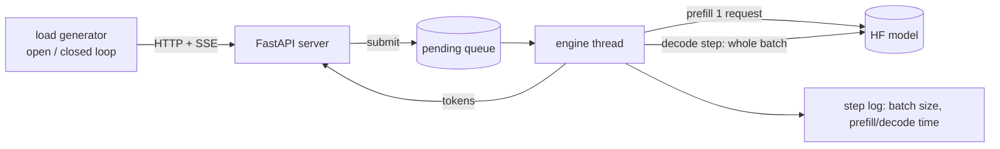

* **One batched forward pass per decode step.** Rows of different lengths share a left-padded KV
  cache `[B, H, T, D]` with an explicit attention mask and per-row position ids.
* **Admission** runs the new request's prefill separately and left-pads/concatenates its cache into
  the running batch; **finished rows** are dropped and all-padding columns trimmed.
* **Policies:** `sequential` (batch of 1), `static` (admit only when the batch has drained),
  `continuous` (admit every step, at most `max_prefill_per_step` prefills per step to bound decode stalls).
* **Correctness:** `tests/test_engine.py` checks that every policy produces exactly the tokens of an
  uncached, unbatched reference (fp64 tiny model), including EOS handling and the background thread.

### The optimized engine

The reference engine's decode step costs ~30 ms at *every* batch size on a T4 (about 10% of the memory
roofline): it is launch/Python-overhead bound, and its growing, re-concatenated KV cache adds allocator work.
`SlotEngine` fixes the cause, not the symptom:

* **Static slots:** `K/V[layer] = [slots, kv_heads, max_ctx, head_dim]`, allocated once; a request owns a slot.
* **Fixed-shape decode:** a hand-written decode step over the HF model's own modules (GQA without copying K/V),
  reading a bucketed prefix of the cache with a per-slot validity mask.
* **CUDA graphs:** every (batch bucket, context bucket) shape is captured once and replayed.
* **Chunked prefill:** long prompts are processed in pieces interleaved with decode steps.
* **Prefix caching:** block-aligned KV reuse for shared prompt prefixes (LRU, byte-capped).

`tests/test_slot_engine.py` checks every combination against an uncached fp64 reference, and (on a GPU) that the
CUDA-graph path matches the eager slot path.

### Serving behaviour

Validation rejects unsupported options (`n>1`, `temperature>0`, `stop`, ...) and over-long inputs with HTTP 400 instead
of ignoring or truncating them. The pending queue and a token budget are bounded (overload returns 503 + `Retry-After`).
Requests carry deadlines (504) and are cancelled when the client disconnects, freeing their KV slot. If the engine
loop raises, every waiting client gets a terminal error and `/health` turns 503. Shutdown stops accepting, drains for a
bounded time, then fails what is left. Streaming uses immutable token events, so a slow consumer never sees duplicated or
merged text (tested).

## Methodology

* **Open-loop** load (Poisson arrivals) for latency/capacity: arrivals do not slow down when the
  server does, so overload shows up as queueing instead of being hidden (coordinated omission).
* **Closed-loop** load only for peak-throughput numbers, with repeats and spread.
* **Workload `mixed`:** prompts of 16-256 words and outputs of 16-256 tokens, fixed output length
  (`ignore_eos`) so every engine does identical work.
* **SLO:** TTFT <= 1 s and TPOT <= 100 ms. *SLO capacity* = highest offered rate where >= 95% of
  requests meet both and none fail. *Goodput* = rate of requests that meet the SLO.
* **TTFT is client-visible:** time to the first chunk with non-empty text (role-only/empty chunks do not count); the
  server also reports engine-side TTFT separately.
* Requests still running 45 s after the last arrival are cancelled and counted as failed (overload).
* **Repeats:** open-loop points run with several seeds and a rate counts as meeting the SLO only if every seed does;
  closed-loop points run with repeats and show mean ± sd.
* **Workloads:** `mixed` (main), `longmix` (12% ~1.3k-token prompts, for chunked prefill), `shared` (common ~250-token
  preamble, for prefix caching). A second model size (Qwen2.5-1.5B) checks that rankings transfer.

## Results

<!-- RESULTS:START -->
**Setup:** model `Qwen/Qwen2.5-0.5B-Instruct`, float16, hardware: Tesla T4, torch 2.11.0+cu130, transformers 5.20.2, run date 2026-10-25 20:43:23 UTC, commit `b441375`.

### Key findings (auto-generated from the data)

- Sequential serving never met the SLO at any tested rate, while continuous-16 sustained 3 req/s, continuous-32 sustained 6 req/s, vllm sustained 12 req/s.
- At 3 req/s (the highest rate where continuous-16 meets the SLO), continuous batching has 195x lower p95 TTFT than static batching of the same size (0.12s vs 22.66s). Static batching meets the SLO at no tested rate.
- Against vLLM on the same GPU, our best engine (continuous-32, SLO capacity 6 req/s) reaches 50% of vLLM's SLO capacity (12 req/s).
- Closed-loop peak: **continuous-16** 303 tok/s = 11.7x sequential (26 tok/s).
- Closed-loop peak: **continuous-32** 469 tok/s = 18.2x sequential (26 tok/s).
- Closed-loop peak: **static-16** 161 tok/s = 6.3x sequential (26 tok/s).
- Closed-loop peak: **vllm** 1399 tok/s = 54.3x sequential (26 tok/s).
- Decode step time is nearly flat in batch size: within 1.5x of batch 1 (35.74 ms) up to batch **32**, where decode tokens/s is 30.7x batch 1. This is why batching raises throughput.
- At batch 128 a decode step takes 104.21 ms, 4.2% of the assumed 320 GB/s peak bandwidth: well below the memory roofline, so the step is not bandwidth-bound; kernel-launch / Python overhead is the likely limiter (check profile_decode.txt).
- Prefill of a 2048-token prompt takes 412.4 ms when only the last position's logits are computed vs 426.9 ms with full-vocab logits at every position (1.0x).
- Computing the lm_head only for the last prompt position raises closed-loop throughput (260 -> 268 tok/s, 1.03x; run-to-run spread is not shown, so treat differences under ~5% as noise) and moves the share of GPU time spent in prefill from 12% to 12%.
- float16/int8: 0.26x throughput vs fp32, perplexity 22.455 vs 22.426, greedy outputs match fp32 for the first 58% of tokens on average.
- float16/nf4: 0.81x throughput vs fp32, perplexity 25.025 vs 22.426, greedy outputs match fp32 for the first 17% of tokens on average.
- float16/none: 1.08x throughput vs fp32, perplexity 22.417 vs 22.426, greedy outputs match fp32 for the first 98% of tokens on average.
- Decode step time (kernel only, no scheduler): CUDA-graph slots are 3.6x-4.6x faster than the HF dynamic-cache step across batch sizes 1-32; the gain shrinks as batch grows because compute, not launch overhead, starts to dominate.
- Static slots + CUDA graphs move SLO capacity from 4 (in [4, 6)) to 10 (in [10, 12)) req/s on the same model, GPU and load (2.50x by the lower bound). Every rate was run with 2 seed(s); a rate counts as meeting the SLO only if every seed does.
- Of the end-to-end gain, CUDA graphs account for 2.02x closed-loop throughput on top of the static-slot engine (477 -> 964 tok/s); the static KV layout alone is the remainder.
- Closed-loop peak throughput: 414 -> 964 tok/s (2.33x); the difference is outside one standard deviation of the repeats.
- Against vLLM on the same GPU, slot+graphs reach 83% of its SLO capacity by lower bounds (10 vs 12 req/s) and 69% of its closed-loop throughput.
- Chunked prefill (chunk-256) on a workload with ~12% long (~1.3k-token) prompts changes p95 TPOT by 1.01x and p95 TTFT by 1.33x relative to whole-prompt prefill (mean over 4 rates; <1 is better).
- Prefix caching on a workload where every prompt shares a ~250-token preamble: mean prefix-token hit rate 89%, p95 TTFT 0.71x-0.96x of the uncached engine across rates (<1 is better; rates beyond saturation are dominated by queueing).
- On the larger second model the slot+graph engine reaches 391 tok/s vs 223 for the dynamic-cache engine at their best concurrency (1.75x), so the ranking holds across model sizes.

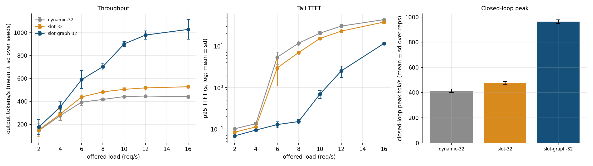

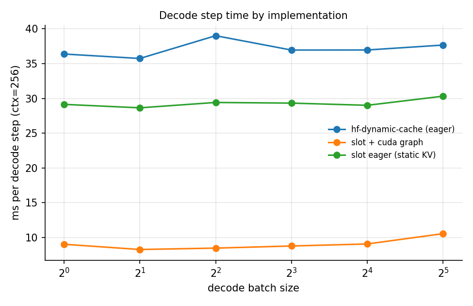

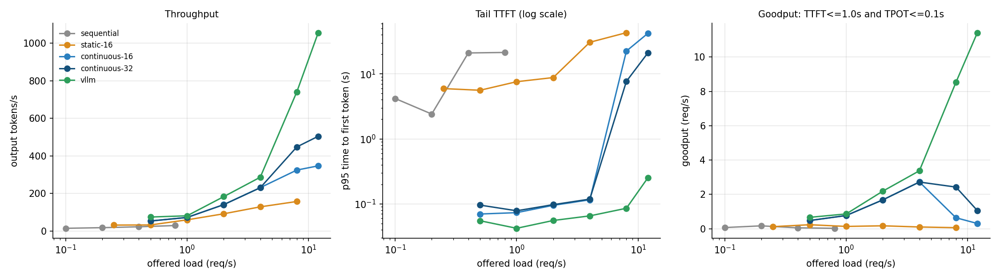

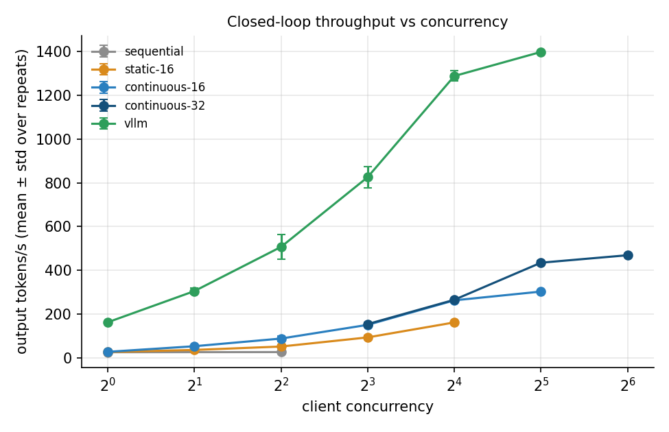

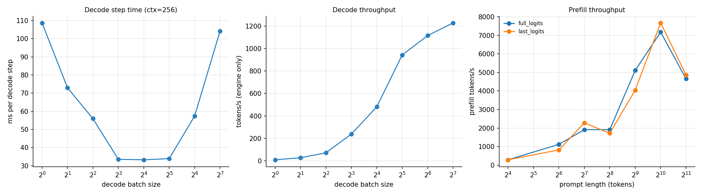

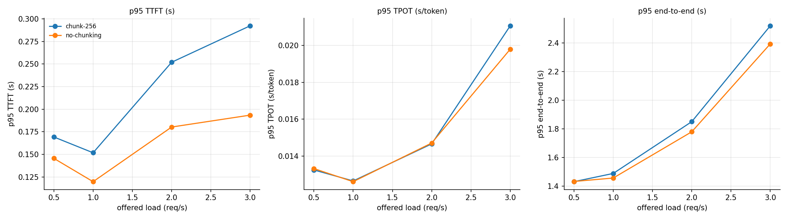

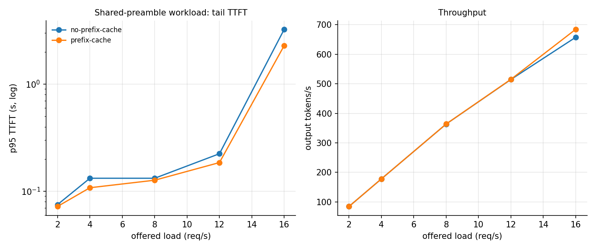

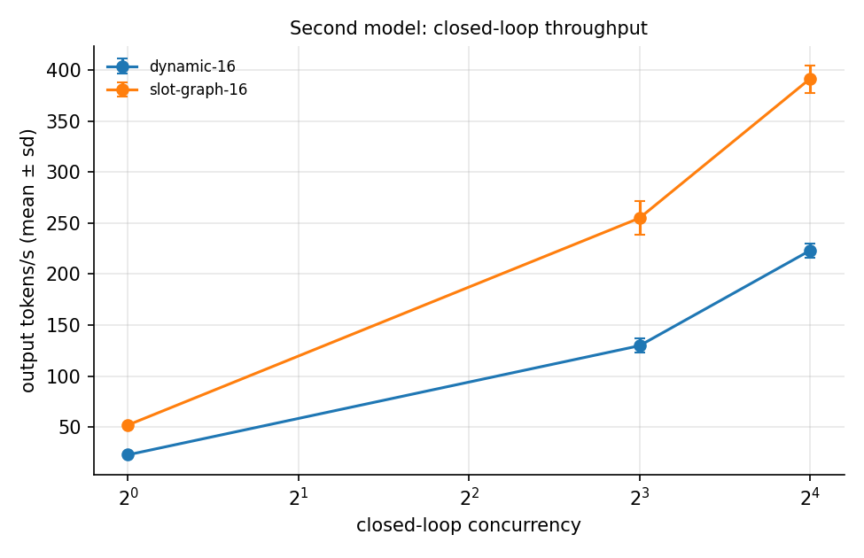

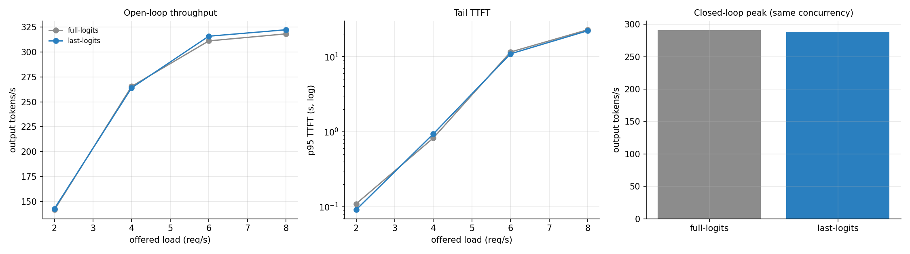

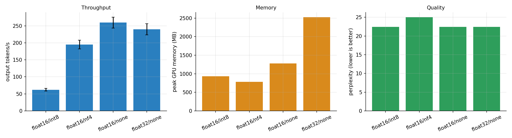

Full tables and methodology: [reports/RESULTS.md](reports/RESULTS.md).
<!-- RESULTS:END -->

## Reproduce

```bash
pip install -e .            # needs a working torch install
make test                   # ~70 CPU tests, ~1 min, no downloads (GPU tests skip themselves)
make smoke                  # full pipeline on CPU with a tiny random model
make t4                     # real experiments on a GPU (Qwen2.5-0.5B-Instruct)
```

The Colab notebook in this repo runs everything end to end and pushes results back.

## Limitations (read before quoting numbers)

* One small model (Qwen2.5-0.5B), one GPU class; results do not transfer to larger models or other GPUs.
* No paged attention: the slot engine reserves `max_ctx` per slot (memory-for-speed trade). Prefill is one request
  (or chunk) at a time. Greedy decoding only; the server rejects sampling parameters rather than ignoring them.
* The slot engine drives the weights directly (Qwen2/Llama-style decoder layers) and does not support the bitsandbytes
  int8/nf4 paths; those use the reference engine.
* vLLM comparisons measure the remaining gap; they are not a claim of parity. The vLLM baseline is reported only if it
  actually completed in the run (the report says so either way).
* 'Greedy agreement' between precisions is numerical consistency, not task quality; perplexity is WikiText-2 only.
* The load generator runs on the same machine as the server (Colab has 2 vCPUs); at high request
  rates this can perturb measurements.
* Free-tier shared GPUs vary between sessions; compare numbers only within one run.
* The quantization experiment measures speed/memory/quality on this model only.

## License

MIT. See [LICENSE](LICENSE).
