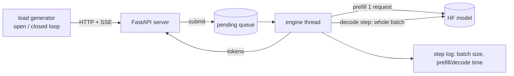

# llm-inference

A small LLM serving stack **built to be measured**: a from-scratch continuous-batching engine for
Hugging Face causal LMs, an OpenAI-compatible server, an open-loop load generator, and a set of
experiments that explain *why* the numbers look the way they do (scheduling, roofline, precision).

Successor to [llm-inference-benchmark-lab](https://github.com/Shivanim042003/llm-inference-benchmark-lab),
which measured a naive CPU server. This project builds the serving system and benchmarks it
against a production engine (vLLM).

## What is in here

| Layer | What | Where |
|---|---|---|
| Engine (reference) | Iteration-level (continuous) batching on a left-padded, growing KV cache; same code path runs sequential, static and continuous policies so comparisons isolate the scheduler | `src/llmserve/engine.py` |
| Engine (optimized) | **Static KV slots**, fixed-shape decode, **CUDA graphs**, **chunked prefill**, **prefix caching**; verified token-for-token against the reference | `src/llmserve/slot_engine.py` |
| Server | OpenAI-compatible `/v1/chat/completions` with SSE streaming; request validation, deadlines, client-disconnect cancellation, bounded queue with HTTP 503, engine-failure propagation, real `/health` and `/ready`, graceful drain | `src/llmserve/server.py` |
| Load generation | Open-loop Poisson arrivals (exposes queueing and tail latency) and closed-loop concurrency | `src/llmserve/loadgen.py` |
| Metrics | TTFT, TPOT, E2E percentiles, **SLO attainment and goodput**, bootstrap CIs | `src/llmserve/metrics.py` |
| Analysis | Prefill/decode microbenchmarks, achieved memory bandwidth vs roofline, `torch.profiler` tables | `src/llmserve/microbench.py` |
| Precision | fp32 / fp16 / int8 / nf4: throughput, GPU memory, perplexity, greedy-output agreement | `src/llmserve/quality.py` |
| Ablation | Prefill computes the lm_head only for the last prompt position vs every position (same server, same load, same session) | `src/llmserve/engine.py`, `experiments.py` |
| Baseline | Same load against vLLM serving the same model | `src/llmserve/experiments.py` |
| Reports | Figures, tables and findings generated from the CSVs (no hand-written numbers) | `src/llmserve/report.py` |

## Design



* **One batched forward pass per decode step.** Rows of different lengths share a left-padded KV
  cache `[B, H, T, D]` with an explicit attention mask and per-row position ids.
* **Admission** runs the new request's prefill separately and left-pads/concatenates its cache into
  the running batch; **finished rows** are dropped and all-padding columns trimmed.
* **Policies:** `sequential` (batch of 1), `static` (admit only when the batch has drained),
  `continuous` (admit every step, at most `max_prefill_per_step` prefills per step to bound decode stalls).
* **Correctness:** `tests/test_engine.py` checks that every policy produces exactly the tokens of an
  uncached, unbatched reference (fp64 tiny model), including EOS handling and the background thread.

### The optimized engine

The reference engine's decode step costs ~30 ms at *every* batch size on a T4 (about 10% of the memory
roofline): it is launch/Python-overhead bound, and its growing, re-concatenated KV cache adds allocator work.
`SlotEngine` fixes the cause, not the symptom:

* **Static slots:** `K/V[layer] = [slots, kv_heads, max_ctx, head_dim]`, allocated once; a request owns a slot.
* **Fixed-shape decode:** a hand-written decode step over the HF model's own modules (GQA without copying K/V),
  reading a bucketed prefix of the cache with a per-slot validity mask.
* **CUDA graphs:** every (batch bucket, context bucket) shape is captured once and replayed.
* **Chunked prefill:** long prompts are processed in pieces interleaved with decode steps.
* **Prefix caching:** block-aligned KV reuse for shared prompt prefixes (LRU, byte-capped).

`tests/test_slot_engine.py` checks every combination against an uncached fp64 reference, and (on a GPU) that the
CUDA-graph path matches the eager slot path.

### Serving behaviour

Validation rejects unsupported options (`n>1`, `temperature>0`, `stop`, ...) and over-long inputs with HTTP 400 instead
of ignoring or truncating them. The pending queue and a token budget are bounded (overload returns 503 + `Retry-After`).
Requests carry deadlines (504) and are cancelled when the client disconnects, freeing their KV slot. If the engine
loop raises, every waiting client gets a terminal error and `/health` turns 503. Shutdown stops accepting, drains for a
bounded time, then fails what is left. Streaming uses immutable token events, so a slow consumer never sees duplicated or
merged text (tested).

## Methodology

* **Open-loop** load (Poisson arrivals) for latency/capacity: arrivals do not slow down when the
  server does, so overload shows up as queueing instead of being hidden (coordinated omission).
* **Closed-loop** load only for peak-throughput numbers, with repeats and spread.
* **Workload `mixed`:** prompts of 16-256 words and outputs of 16-256 tokens, fixed output length
  (`ignore_eos`) so every engine does identical work.
* **SLO:** TTFT <= 1 s and TPOT <= 100 ms. *SLO capacity* = highest offered rate where >= 95% of
  requests meet both and none fail. *Goodput* = rate of requests that meet the SLO.
* **TTFT is client-visible:** time to the first chunk with non-empty text (role-only/empty chunks do not count); the
  server also reports engine-side TTFT separately.
* Requests still running 45 s after the last arrival are cancelled and counted as failed (overload).
* **Repeats:** open-loop points run with several seeds and a rate counts as meeting the SLO only if every seed does;
  closed-loop points run with repeats and show mean ± sd.
* **Workloads:** `mixed` (main), `longmix` (12% ~1.3k-token prompts, for chunked prefill), `shared` (common ~250-token
  preamble, for prefix caching). A second model size (Qwen2.5-1.5B) checks that rankings transfer.

## Results

<!-- RESULTS:START -->
_Run the experiments and `python -m llmserve.report` to fill this block._
<!-- RESULTS:END -->

## Reproduce

```bash
pip install -e .            # needs a working torch install
make test                   # ~70 CPU tests, ~1 min, no downloads (GPU tests skip themselves)
make smoke                  # full pipeline on CPU with a tiny random model
make t4                     # real experiments on a GPU (Qwen2.5-0.5B-Instruct)
```

The Colab notebook in this repo runs everything end to end and pushes results back.

## Limitations (read before quoting numbers)

* One small model (Qwen2.5-0.5B), one GPU class; results do not transfer to larger models or other GPUs.
* No paged attention: the slot engine reserves `max_ctx` per slot (memory-for-speed trade). Prefill is one request
  (or chunk) at a time. Greedy decoding only; the server rejects sampling parameters rather than ignoring them.
* The slot engine drives the weights directly (Qwen2/Llama-style decoder layers) and does not support the bitsandbytes
  int8/nf4 paths; those use the reference engine.
* vLLM comparisons measure the remaining gap; they are not a claim of parity. The vLLM baseline is reported only if it
  actually completed in the run (the report says so either way).
* 'Greedy agreement' between precisions is numerical consistency, not task quality; perplexity is WikiText-2 only.
* The load generator runs on the same machine as the server (Colab has 2 vCPUs); at high request
  rates this can perturb measurements.
* Free-tier shared GPUs vary between sessions; compare numbers only within one run.
* The quantization experiment measures speed/memory/quality on this model only.

## License

MIT. See [LICENSE](LICENSE).
