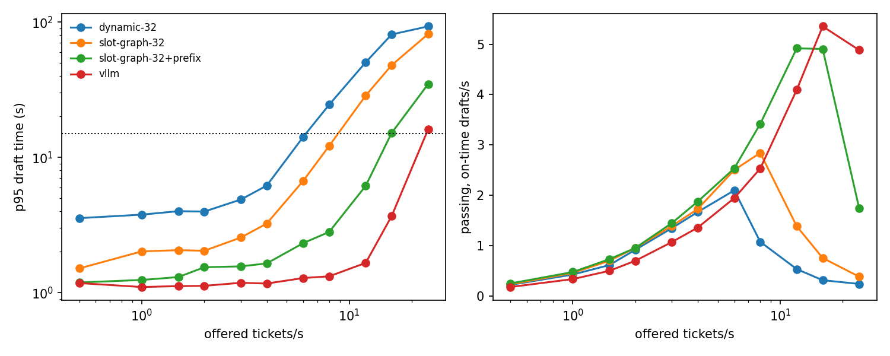

# SupportDraft: results

All tickets and the knowledge base are **synthetic** (a fictional product, 'PebbleBoard'). Labels used below: **MEASURED** = observed in the run; **AUTOMATED** = deterministic quality check, not human-verified; **ASSUMPTION** = an input chosen by the author; **ESTIMATE** = arithmetic on measured numbers and assumptions. No reviewer time, user behaviour or real cost saving was measured.

Setup: model `Qwen/Qwen2.5-1.5B-Instruct`, split `test`, latency objective: draft complete within 15.0 s (a draft is *useful* only if it passes the automated checks AND arrives in time); time to first token objective 2.0 s is reported separately.

## 1. Retrieval (MEASURED, backend-independent)

| split | recall@1 | recall@3 |
|---|---|---|
| dev | 1.000 | 1.000 |
| test | 0.956 | 1.000 |

Share of answerable tickets whose correct passage is among the top-k retrieved. BM25 with light stemming over 30 passages is an easy retrieval problem; this does not predict retrieval on a large, messy knowledge base.

## 2. Draft quality (AUTOMATED, test split)

| backend | overall correct | answerable: correct | fact coverage | citation supports claim | invented numbers | known-wrong values | copied from passage | over-escalated | escalation recall |
|---|---|---|---|---|---|---|---|---|---|
| dynamic-32 | 44% | 40% | 63% | 72% | 13% | 0% | 18% | 13% | 58% |
| slot-graph-32 | 46% | 42% | 64% | 74% | 13% | 0% | 18% | 13% | 58% |
| slot-graph-32+prefix | 49% | 47% | 67% | 77% | 10% | 0% | 17% | 13% | 58% |
| baseline: always escalate | 21% | 0% | 0% | n/a | n/a | n/a | n/a | 100% | 100% |
| baseline: quote top-1 passage (no LLM) | 81% | 96% | 96% | 96% | 0% | 0% | 96% | 0% | 25% |

Measured at each backend's lowest offered rate. Greedy decoding makes quality nearly independent of load; the spread of the overall correct rate across offered rates was dynamic-32: 44%-45%, slot-graph-32: 44%-47%, slot-graph-32+prefix: 45%-49%. The two baseline rows use no language model and are scored by the same checks: quoting the top retrieved passage already satisfies the rules on most answerable tickets, so the checks cannot separate a tailored reply from a copy-paste ('copied from passage' shows how much of each draft is verbatim source text). A language model adds value mainly through escalation recall and through answering the actual question, which these checks only partly capture. These are rule-based checks: they verify required facts, cited-source support, invented numbers, known-wrong values and escalation. They do not judge tone, completeness or subtle errors; use the human review sheet for that.

- `dynamic-32` outcomes: ok 25, missing_fact 14, bad_citation 7, over_escalated 6, missed_escalation 5
- `slot-graph-32` outcomes: ok 26, missing_fact 13, bad_citation 7, over_escalated 6, missed_escalation 5
- `slot-graph-32+prefix` outcomes: ok 28, missing_fact 12, bad_citation 6, over_escalated 6, missed_escalation 5

Correct rate by ticket kind for `dynamic-32`: escalate 58% (n=12), hard 33% (n=30), terse 53% (n=15)

## 3. Serving under a ticket spike (MEASURED)

| backend | offered/s | requests | failed | p95 TTFT (s) | p95 draft time (s) | on time | useful | useful drafts/s |
|---|---|---|---|---|---|---|---|---|
| dynamic-32 | 0.50 | 57 | 0 | 0.17 | 3.55 | 100% | 44% | 0.22 |
| dynamic-32 | 1.00 | 57 | 0 | 0.18 | 3.77 | 100% | 44% | 0.42 |
| dynamic-32 | 1.50 | 57 | 0 | 0.23 | 4.00 | 100% | 44% | 0.61 |
| dynamic-32 | 2.00 | 114 | 0 | 0.26 | 3.97 | 100% | 45% | 0.92 |
| dynamic-32 | 3.00 | 114 | 0 | 0.33 | 4.87 | 100% | 45% | 1.35 |
| dynamic-32 | 4.00 | 171 | 0 | 0.60 | 6.18 | 100% | 44% | 1.67 |
| dynamic-32 | 6.00 | 228 | 0 | 4.72 | 14.17 | 96% | 44% | 2.10 |
| dynamic-32 | 8.00 | 285 | 0 | 18.04 | 24.50 | 49% | 23% | 1.07 |
| dynamic-32 | 12.00 | 399 | 0 | 45.11 | 50.42 | 23% | 11% | 0.53 |
| dynamic-32 | 16.00 | 513 | 0 | 74.76 | 80.96 | 14% | 7% | 0.31 |
| dynamic-32 | 24.00 | 741 | 219 | 86.01 | 92.87 | 8% | 4% | 0.24 |
| slot-graph-32 | 0.50 | 57 | 0 | 0.17 | 1.51 | 100% | 46% | 0.23 |
| slot-graph-32 | 1.00 | 57 | 0 | 0.18 | 2.02 | 100% | 46% | 0.46 |
| slot-graph-32 | 1.50 | 57 | 0 | 0.19 | 2.06 | 100% | 47% | 0.70 |
| slot-graph-32 | 2.00 | 114 | 0 | 0.23 | 2.04 | 100% | 46% | 0.95 |
| slot-graph-32 | 3.00 | 114 | 0 | 0.29 | 2.55 | 100% | 45% | 1.39 |
| slot-graph-32 | 4.00 | 171 | 0 | 0.47 | 3.24 | 100% | 44% | 1.73 |
| slot-graph-32 | 6.00 | 228 | 0 | 0.69 | 6.71 | 100% | 45% | 2.50 |
| slot-graph-32 | 8.00 | 285 | 0 | 5.62 | 12.15 | 99% | 45% | 2.84 |
| slot-graph-32 | 12.00 | 399 | 0 | 24.80 | 28.62 | 44% | 21% | 1.38 |
| slot-graph-32 | 16.00 | 513 | 0 | 43.91 | 47.98 | 25% | 12% | 0.75 |
| slot-graph-32 | 24.00 | 741 | 0 | 77.40 | 81.58 | 12% | 6% | 0.38 |
| slot-graph-32+prefix | 0.50 | 57 | 0 | 0.08 | 1.19 | 100% | 49% | 0.25 |
| slot-graph-32+prefix | 1.00 | 57 | 0 | 0.08 | 1.24 | 100% | 47% | 0.47 |
| slot-graph-32+prefix | 1.50 | 57 | 0 | 0.08 | 1.30 | 100% | 49% | 0.73 |
| slot-graph-32+prefix | 2.00 | 114 | 0 | 0.09 | 1.54 | 100% | 46% | 0.95 |
| slot-graph-32+prefix | 3.00 | 114 | 0 | 0.10 | 1.56 | 100% | 46% | 1.45 |
| slot-graph-32+prefix | 4.00 | 171 | 0 | 0.12 | 1.64 | 100% | 47% | 1.87 |
| slot-graph-32+prefix | 6.00 | 228 | 0 | 0.16 | 2.32 | 100% | 45% | 2.53 |
| slot-graph-32+prefix | 8.00 | 285 | 0 | 0.21 | 2.81 | 100% | 46% | 3.42 |
| slot-graph-32+prefix | 12.00 | 399 | 0 | 2.25 | 6.16 | 100% | 46% | 4.92 |
| slot-graph-32+prefix | 16.00 | 513 | 0 | 12.56 | 15.14 | 94% | 44% | 4.91 |
| slot-graph-32+prefix | 24.00 | 741 | 0 | 32.51 | 34.83 | 32% | 15% | 1.74 |

## 4. Capacity and cost

ASSUMPTION: GPU price 0.35 USD/hour (set `results/processed/supportdraft_assumptions.json` to change it). 'Sustainable rate' = highest tested offered rate with zero failures and at least 95% of drafts on time.

| backend | sustainable_rate | useful_rate_at_cap | saturated_usd_per_1k_useful | est_agents_supported | est_provisioned_usd_per_1k_useful | est_utilization |
|---|---|---|---|---|---|---|
| dynamic-32 | 6 (next tested 8 failed) | 44% | 0.046 | 3600.000 | 2.660 | 0.014 |
| slot-graph-32 | 8 (next tested 12 failed) | 45% | 0.034 | 4800.000 | 2.578 | 0.010 |
| slot-graph-32+prefix | 12 (next tested 16 failed) | 46% | 0.020 | 7200.000 | 2.530 | 0.007 |

- *saturated_usd_per_1k_useful* (MEASURED duration x ASSUMED price): GPU cost while the benchmark ran, per 1,000 useful drafts; assumes the GPU is fully busy.
- *est_agents_supported*, *est_provisioned_usd_per_1k_useful*, *est_utilization* (ESTIMATE): assume 50 agents each requesting 6 drafts per hour for 10 service hours per day. The provisioned cost includes idle GPU time in the service window, so a lightly used deployment looks much more expensive per useful draft than the saturated figure suggests. Change the assumptions to match a real team.

## 5. Labor value (ESTIMATE only; no reviewer time was measured)

Monthly value = tickets per month x share of drafts a person accepts x minutes saved per accepted draft x agent cost per minute, minus GPU cost. Agent cost is ASSUMED at 30 USD/hour. Minutes saved and acceptance are **unknown until a pilot measures them**; the table is a sensitivity analysis, not a result.

| tickets_per_month | acceptance | minutes_saved_per_accepted_draft | est_gross_value_usd | est_gpu_cost_usd | est_net_usd |
|---|---|---|---|---|---|
| 2000 | 50% | 1 | 500 | 77 | 423 |
| 2000 | 50% | 3 | 1500 | 77 | 1423 |
| 2000 | 50% | 5 | 2500 | 77 | 2423 |
| 2000 | 70% | 1 | 700 | 77 | 623 |
| 2000 | 70% | 3 | 2100 | 77 | 2023 |
| 2000 | 70% | 5 | 3500 | 77 | 3423 |
| 2000 | 90% | 1 | 900 | 77 | 823 |
| 2000 | 90% | 3 | 2700 | 77 | 2623 |
| 2000 | 90% | 5 | 4500 | 77 | 4423 |
| 10000 | 50% | 1 | 2500 | 77 | 2423 |
| 10000 | 50% | 3 | 7500 | 77 | 7423 |
| 10000 | 50% | 5 | 12500 | 77 | 12423 |
| 10000 | 70% | 1 | 3500 | 77 | 3423 |
| 10000 | 70% | 3 | 10500 | 77 | 10423 |
| 10000 | 70% | 5 | 17500 | 77 | 17423 |
| 10000 | 90% | 1 | 4500 | 77 | 4423 |
| 10000 | 90% | 3 | 13500 | 77 | 13423 |
| 10000 | 90% | 5 | 22500 | 77 | 22423 |

## 6. Human review (PILOT-MEASURED, small sample)

| sheet | n_reviewed | approve_rate | accept_or_edit_rate | reject_rate | automated_vs_human_agreement | auto_pass_but_human_reject | auto_fail_but_human_accept | mean_review_seconds |
|---|---|---|---|---|---|---|---|---|
| review_slot-graph-32.csv | 30 | 0.233 | 0.533 | 0.467 | 0.733 | 3 | 5 | 21.290 |

## Limits

- Synthetic knowledge base and tickets written by the author; real tickets are messier. The test split was not used to tune prompts, but retrieval stemming was added after looking at retrieval misses that included test tickets.
- Automated checks are rule-based; they can pass a poor draft and fail an acceptable one.
- One model, one GPU, greedy decoding, Poisson arrivals; the ticket set is small (see `n` above).
- Cost depends on an assumed GPU price; labor value depends on assumptions that were not measured.

## Provenance and caveats

- **Human review is not independent.** One reviewer (the author) judged 30 drafts. For most of them, Claude, the assistant that helped build this project, suggested a verdict in the same session before the reviewer answered. Treat the agreement numbers as indicative, not as an independent check.
- **Test-split hygiene.** The prompt was tuned on the dev split only. When the first test run was stopped, one partial result from the earlier prompt (dynamic-32 at 0.5 req/s, 21% correct) had been seen. The test numbers above come from a clean rerun with the final prompt.
- **Template copying.** In 7 of 13 escalation drafts at the lowest rate, the model repeated the example reason from the prompt word for word, so escalation reasons are often not tailored.
- Differences of a few points in correctness between engines (44% to 49%) are within run-to-run and fp16 noise; one run per point.
